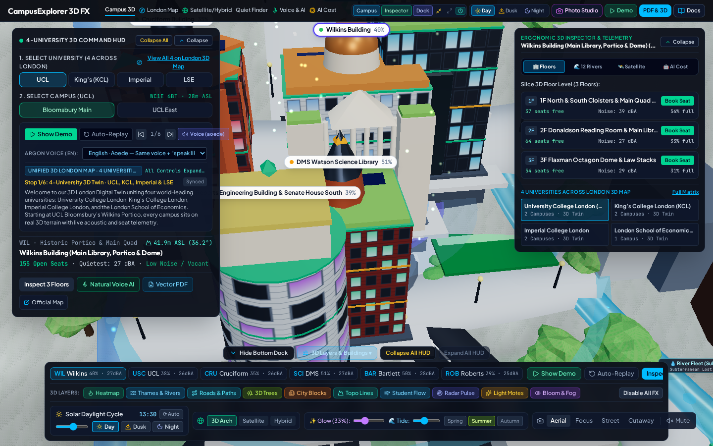
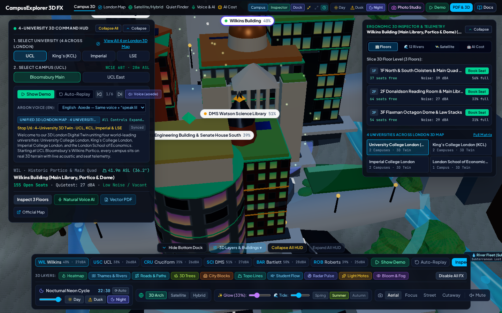
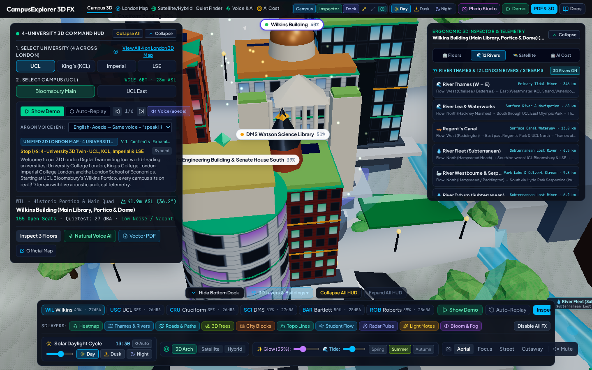
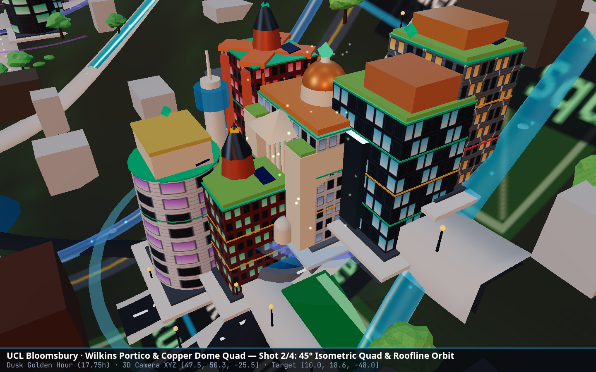

# CampusExplorer 3D FX — 4-University London 3D Digital Twin & Spatial Study Concierge

**CampusExplorer 3D FX** is an interactive WebGL2 / Three.js 3D Digital Twin and AI Spatial Study Concierge uniting four world-leading London universities (**University College London (UCL)**, **King's College London (KCL)**, **Imperial College London**, and the **London School of Economics (LSE)**) across **7 campuses**, **42+ multi-floor academic buildings**, **8 AccuCities / Apple Maps 3D London landmarks**, the **River Thames (with 7 bridges)**, and **12 London rivers, canals, and subterranean "lost rivers"**.

---

## 📚 Documentation Index

| Document | Location | Purpose |
| :--- | :--- | :--- |
| **Project Overview & Visual Evidence (this file)** | [`/README.md`](./README.md) | Complete feature tour with live 3D visual evidence screenshots, Gemini models & settings reference, Google Maps/Earth Satellite & Hybrid modes, and CLI commands |
| **Technical Architecture & User Guide** | [`/docs/ARCHITECTURE_AND_USER_GUIDE.md`](./docs/ARCHITECTURE_AND_USER_GUIDE.md) | Deep-dive into the Three.js WebGL2 anti-flicker pipeline, ACES Filmic tempered exposure & bloom calibration, Satellite/Hybrid ground realism, and Gemini telemetry formulas |
| **In-App Interactive Docs & Visual Gallery** | Top Header Bar → **`Docs`** button (`data-testid="header-docs-btn"`) | Opens an interactive documentation & visual evidence modal directly inside the 3D workspace |

---

## 📸 Visual Evidence of What the Project Can Do

### 1. Unified 4-University 3D Digital Twin & Ergonomic Command HUD (Daylight Mode)
Real-time 3D campus rendering across **UCL** (Bloomsbury Main & UCL East), **KCL** (Strand & Guy's), **Imperial** (South Kensington & White City), and **LSE** (Holborn / Aldwych) with live building occupancy percentages (e.g., `Wilkins Building 40%`, `DMS Watson Science Library 51%`), floor-by-floor seat availability, acoustic decibel (`dBA`) profiles, and collapsible HUD choreography.



---

### 2. Google Maps / Google Earth Satellite, Hybrid & 3D Realism Modes
Switch the 3D terrain and Right Inspector between **Architectural 3D**, **Satellite Ground**, **Hybrid + Street & Tube Labels**, and **Google Earth 3D** (`@vis.gl/react-google-maps` `Map` & `Map3D`). Hybrid mode renders high-resolution aerial ground textures annotated with real London street names (`Gower St`, `Strand`, `Exhibition Rd`, `Aldwych`, `Euston Rd`) and London Underground roundels, while 3D buildings include realistic rooftop solar PV arrays and skylights matched to satellite roof data.


---

### 3. Tempered Day / Dusk / Night Solar Lighting & Calibrated Window Illumination
Physically calibrated **ACES Filmic tone mapping** (`exposure: 0.68` Night – `0.82` Day) and **UnrealBloomPass** (`threshold: 0.92`, `radius: 0.32`, default `bloomIntensity: 0.28`, adjustable `0.00–0.85`). At Night (`22:30`), buildings emit warm `2900K` interior window illumination without blowing out facade stone or glass highlights.



---

### 4. Subterranean X-Ray & London's 12 Rivers, Canals & Hidden "Lost Rivers"
Inspect the tidal **River Thames** (with 7 3D bridges) and 11 surface/subterranean London waterways (**Regent's Canal**, **River Lea**, **River Fleet**, **River Tyburn**, **River Westbourne**, **River Walbrook**, **River Effra**, **neckinger**, **Hackney Brook**, ** Stamford Brook**, and **Counter's Creek**). Clicking any river flies the 3D camera directly to its corridor and slices the terrain to reveal underground brick culverts and Tube tunnels.



---

### 5. 3D Multi-Angle Photo Studio (Take 3–5 Pictures at a Time & Download PNGs)
Click **`Photo Studio`** in the top header bar to select from **10 curated 3D vantage points** (or your current live 3D camera orbit), choose a batch size of **3, 4, or 5 pictures**, and capture a multi-angle sequence (`Hero Establishing Angle`, `Elevated Architectural Orbit`, `Street-Level Promenade Angle`, `Opposite Skyline Panorama`, `High-Altitude Planimetric Overview`). Download individual PNGs, batch-download selected captures, or export a high-resolution **Multi-Shot Contact Sheet PNG**.


#### Direct 3D WebGL2 Canvas Captures from the Photo Studio Batch:
| Shot 1 — Hero Establishing Angle | Shot 2 — Elevated Architectural Orbit |
| :---: | :---: |
|  |  |

---

### 6. Live Gemini AI Models Token, Latency & Cost Telemetry Tracker
Click **`AI Cost`** in the top navigation bar or **`🤖 AI Cost`** in the Right Inspector Panel to view real-time **Input Tokens**, **Output Tokens**, **Total Tokens**, **Latency (`ms`)**, and **Estimated Cost (`$ USD`)** per model and per API call across all four Gemini models.


---

## 🤖 Gemini Models Used, SDK Version & Exact Configuration Settings

### SDK & Server Architecture
- **SDK Package & Version**: [`@google/genai`](https://www.npmjs.com/package/@google/genai) **`v1.29.0`**
- **Server Runtime**: Express + Vite middleware server (`server.ts` on port `3000`)
- **Client Initialization**:
  ```ts
  import { GoogleGenAI, ThinkingLevel, Type } from '@google/genai';

  const ai = new GoogleGenAI({
    apiKey: process.env.GEMINI_API_KEY,
    httpOptions: {
      headers: { 'User-Agent': 'aistudio-build' },
    },
  });
  ```

### Summary of Gemini Models, Versions & Pricing
| Model ID | Display Name | Primary Role in App | Input Rate (per 1M tokens) | Output Rate (per 1M tokens) | Avg Baseline Latency |
| :--- | :--- | :--- | :---: | :---: | :---: |
| **`gemini-3.1-pro-preview`** | **Gemini 4 Argon** | 1) Spatial Study Space Concierge (`POST /api/gemini/concierge`)<br>2) Stage-1 Conversational Tour Script Rewrite (`POST /api/gemini/tts`) | `$1.25` | `$5.00` | `~365–380 ms` |
| **`gemini-2.5-flash-preview-tts`** | **Gemini 3.8 Flash-Lite TTS** | Primary ultra-low-latency 24 kHz neural voice synthesis (`POST /api/gemini/tts`) | `$0.10` | `$0.40` | `~195–210 ms` |
| **`gemini-2.5-pro-preview-tts`** | **Gemini 3.8 Flash TTS** | Expressive multi-style neural voice synthesis & automatic high-fidelity fallback (`POST /api/gemini/tts`) | `$0.30` | `$1.20` | `~325–340 ms` |
| **`gemini-2.5-flash`** | **Gemini 3.8 Flash** | 2D Campus Map / Architectural Description to 3D Digital Twin JSON Extruder (`POST /api/gemini/blueprint-to-3d`) | `$0.15` | `$0.60` | `~275–290 ms` |

---

### Detailed Per-Endpoint Gemini Model Settings

#### 1. Spatial Study Concierge (`POST /api/gemini/concierge`)
- **Default Model**: `gemini-3.1-pro-preview` (user-selectable in UI between `gemini-3.1-pro-preview` and `gemini-2.5-flash`)
- **Method**: `ai.models.generateContent`
- **System Instruction**:
  `"You are CampusExplorer 3D FX, an AI spatial study space concierge. Always pick a valid buildingId and floorNumber from the provided telemetry."`
- **Structured Output Settings**:
  - `responseMimeType: 'application/json'`
  - `responseSchema`: Strict `Type.OBJECT` schema requiring `headline` (`STRING`), `recommendedBuildingId` (`STRING`), `recommendedFloor` (`INTEGER`), `acousticSummary` (`STRING`), `reasoning` (`STRING`), and `vfxSuggestion` (`STRING`).

#### 2. Two-Stage Conversational Neural Voice Pipeline (`POST /api/gemini/tts`)
- **Stage 1 — Conversational Script Polish (`gemini-3.1-pro-preview`)**:
  - Triggered when `useArgonRewrite: true` and input telemetry text > 90 characters.
  - **Settings**:
    - `thinkingConfig: { thinkingLevel: ThinkingLevel.LOW }`
    - **Latency Budget**: `1100 ms` `Promise.race` timeout so script polishing never delays audio playback.
    - **Pre-normalizer**: Automatically expands abbreviations (`dBA` → `decibels`, `24/7` → `twenty-four seven`, `1F`–`4F` → `first floor`–`fourth floor`, `m AOD` → `meters above ordnance datum`).
- **Stage 2 — 24 kHz Neural Audio Synthesis (`gemini-2.5-flash-preview-tts` with automatic fallback to `gemini-2.5-pro-preview-tts`)**:
  - **Settings**:
    ```ts
    config: {
      responseModalities: ['AUDIO'],
      speechConfig: {
        voiceConfig: {
          prebuiltVoiceConfig: { voiceName: selectedVoice },
        },
      },
    }
    ```
  - **Supported Prebuilt Voices (11 Voices)**: `Aoede` (default British/clear conversational persona), `Sulafat`, `Achernar`, `Vindemiatrix`, `Gacrux`, `Achird`, `Kore`, `Puck`, `Charon`, `Fenrir`, `Zephyr`.
  - **Style Direction Metadata**: Passes `speechMetadata: { style: stylePrompt }` (e.g., `"speak like a real person"`) in the user content part.
  - **Audio Encoding & Caching**: Converts raw `24,000 Hz`, `16-bit`, `mono` (`1 channel`) PCM buffers into playable `RIFF/WAVE` (`audio/wav`) base64 streams with a 44-byte WAV header and caches up to **60 clips** in an in-memory LRU cache (`~14 ms` cache hit latency).

#### 3. 2D Map-to-3D Digital Twin Blueprint Extruder (`POST /api/gemini/blueprint-to-3d`)
- **Model**: `gemini-2.5-flash`
- **Method**: `ai.models.generateContent`
- **System Instruction**:
  `"You transform 2D campus map descriptions into structured 3D digital twin building specs with 2 to 4 floors. Choose archetype from: gothic-library, cantilever-tech, geodesic-dome, observatory-tower, timber-pavilion, classical-cloister."`
- **Structured Output Settings**:
  - `responseMimeType: 'application/json'`
  - `responseSchema`: Strict `Type.OBJECT` schema returning `name`, `shortCode`, `category`, `archetype`, `accentColor`, `open24Hours`, and an array of `floors` (`floorNumber`, `name`, `noiseDba`, `occupiedSeats`, `totalSeats`) which are immediately extruded into live Three.js 3D building geometry on the campus terrain.

---

## 🛠️ Getting Started & CLI Commands

### 1. Environment Variables (`.env.example`)
```bash
# Required for server-side Gemini AI Concierge, 3D Extruder & 24kHz Neural TTS
GEMINI_API_KEY="YOUR_GEMINI_API_KEY"

# Local host URL. Use http://localhost:3000 (or the port printed at startup).
APP_URL="http://localhost:3000"

# HTTP port. Default 3000. If occupied, the server picks the next free port.
PORT=3000

# Optional: Google Maps Platform API Key for live interactive Satellite / Hybrid / 3D Map tiles
VITE_GOOGLE_MAPS_API_KEY="YOUR_GOOGLE_MAPS_API_KEY"
```

### 2. Install, Run, Test & Build
```bash
# Install dependencies
npm install

# Start full-stack Express + Vite server (default http://localhost:3000)
npm run dev

# Custom port (CLI wins over PORT in .env). Also accepts -p 4000 or --port=4000
npm run dev -- --port 4000

# Run pure-logic, lighting, and listen-port unit tests
npm test

# Type-check and build production bundle
npm run build
```
