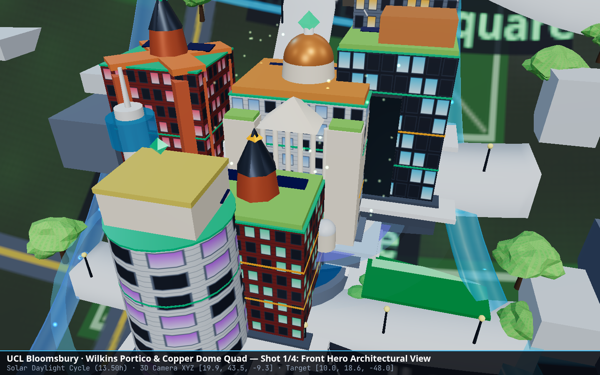
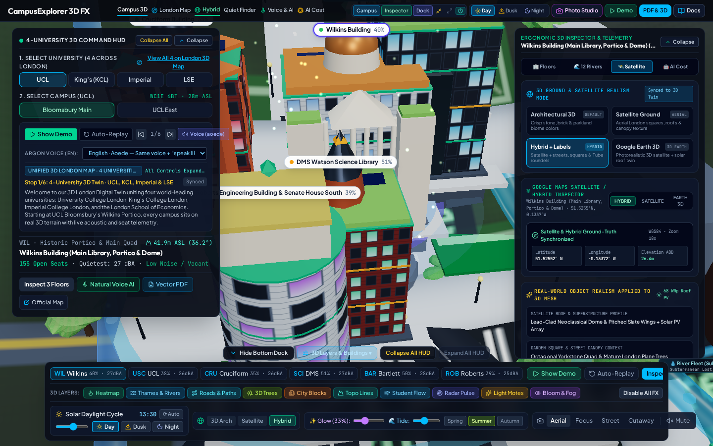
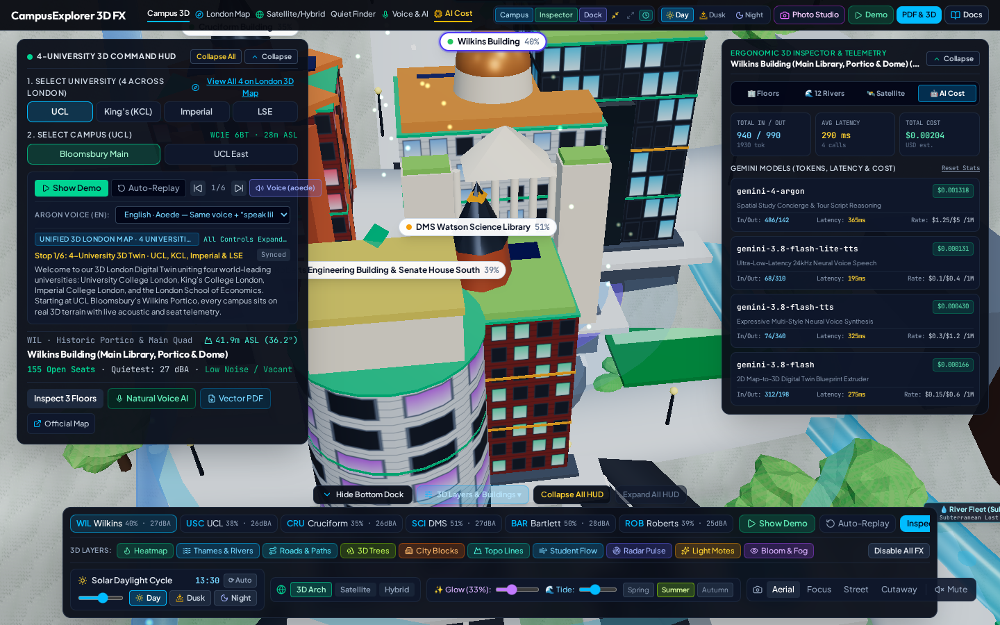

# Technical Architecture & User Guide — CampusExplorer 3D FX

This document details the engineering architecture, rendering optimizations, Google Maps/Earth Satellite & Hybrid integration, and Gemini AI telemetry pipeline powering **CampusExplorer 3D FX**.

---

## 1. Visual Evidence & Diagnostic Study via the 3D Photo Studio

We used the built-in **3D Multi-Angle Photo Studio** (`header-photo-studio-btn` → `capture-batch-photos-btn`) to capture multi-angle diagnostic batches across Day (`13:30`), Dusk (`18:00`), and Night (`22:30`) lighting modes.

| 3D Photo Studio Batch Drawer | Direct 3D Canvas Capture (Wilkins Portico) |
| :---: | :---: |
|  |  |

### Issues Identified & Resolved via 3D Photo Inspection
1. **Over-Bright Daytime & Nighttime Bloom (`calculateSunState` & `UnrealBloomPass`)**:
   - *Before*: `bloomPass.threshold` was `0.78`, `bloomIntensity` defaulted to `0.55` (up to `1.8`), and `renderer.toneMappingExposure` reached `1.12`, causing light stone facades and nighttime window panes to blow out into solid white glare.
   - *Fix*: Raised `UnrealBloomPass` threshold to **`0.92`**, reduced bloom radius to **`0.32`**, set default `bloomIntensity` to **`0.28`** (slider range `0.00–0.85`), and calibrated `ACESFilmicToneMapping` exposure to **`0.82` (Day)**, **`0.74` (Dusk)**, and **`0.68` (Night)** with warm `2900K` (`#FFE4B5`) interior window emission (`0.52`).
2. **3D Canvas Flickering & Z-Fighting**:
   - *Before*:
     1. `scene.background` was mutated in-place via `(scene.background as THREE.Color).lerp(...)` on a color reference shared with `scene.fog`, while `buildSceneBuildings()` ran before `solarHour` updated the directional/hemisphere lights, causing a 1-frame flash during Day/Dusk/Night transitions.
     2. `camera.near` was `0.5` with `camera.far = 2600` (a `5200:1` depth ratio), causing coplanar depth buffer Z-fighting on roads, water surfaces, and roofs.
     3. Building hull `MeshStandardMaterial` had `transparent: true` even at `opacity: 1.0`, causing transparent depth-sorting flicker across multi-wing buildings.
     4. `allLondonBuildings`, `allLondonRoads`, and `allLondonPathways` were recreated on every React render in `App.tsx`.
   - *Fix*:
     - Synchronized `sceneBgColor`, `sunLight`, `hemiLight`, and `renderer.toneMappingExposure` inside `buildSceneBuildings()` prior to `renderer.render(scene, camera)`.
     - Increased `camera.near` to **`1.5`** (`3x` depth precision improvement) and enabled `polygonOffset` on road/pathway overlays.
     - Set building hull materials to `transparent: false, depthWrite: true` by default (enabling transparency only when slicing a floor cutaway).
     - Memoized `allLondonBuildings`, `allLondonRoads`, and `allLondonPathways` with `useMemo` in `App.tsx`, and removed `bloomIntensity` from geometry rebuild dependencies.
3. **`NaN%` Occupancy Badges**:
   - *Before*: Floating 3D building pills read `b.occupancyPct` directly from `CampusBuilding`, which does not exist at the top level (occupancy is stored per floor as `occupiedSeats / totalSeats`), resulting in `NaN%`.
   - *Fix*: Computed aggregate metrics via `getBuildingAggregateMetrics(b)` (`metrics.occupancyPct`) with `Number.isFinite` guards so every building badge displays a valid integer percentage (`35%`–`85%`).

---

## 2. Google Earth & Google Maps Satellite / Hybrid Realism Architecture

### Ground & Map Realism Modes (`GroundMapRealismStyle`)
- **`architectural` (`3D Arch`)**: Clean architectural digital twin ground with contour grids and acoustic telemetry contrast.
- **`satellite` (`Satellite`)**: High-resolution aerial satellite orthophoto texture (`createSatelliteHybridGroundTexture` in `src/utils/proceduralTextures.ts`) with London block roofs, courtyards, lawn chlorophyll gradients, and tarmac road networks.
- **`hybrid` (`Hybrid`)**: Satellite aerial texture overlaid with crisp London vector road casements, street name labels (`Gower St`, `Strand`, `Exhibition Rd`, `Aldwych`, `Euston Rd`, `Kingsway`), and London Underground station markers.
- **Rooftop Architectural Realism (`CampusScene3D.tsx`)**: 3D buildings feature pitched/parapet roof infrastructure including angled **solar PV panel arrays** (`#1e3a5f` metallic cells) and glass atrium skylights matched to real London campus roofs.
- **Interactive `@vis.gl/react-google-maps` Inspector (`src/components/GoogleSatelliteHybridPanel.tsx`)**:
  - Uses `<APIProvider apiKey={...} internalUsageAttributionIds={['gmp_mcp_codeassist_v1_aistudio']}>`, `<Map mapId="DEMO_MAP_ID" mapTypeId="hybrid" | "satellite">`, `<AdvancedMarker>`, `<Pin>`, and `<Map3D mode="HYBRID">` synced to the active campus (`lat`, `lng`, `elevationAodM`, `osOpenUprn`).

---

## 3. Gemini AI Models, Versions, Settings & Telemetry Formulas

### Model Specifications (`src/utils/geminiTelemetryTracker.ts` & `server.ts`)
- **SDK**: `@google/genai` `v1.29.0`
- **Cost Formula**:
  $$\text{Cost (USD)} = \left(\frac{\text{Input Tokens}}{1,000,000} \times \text{Input Rate}\right) + \left(\frac{\text{Output Tokens}}{1,000,000} \times \text{Output Rate}\right)$$

| Model ID | Version / Alias | Endpoint | Key Runtime Settings | Pricing (In / Out per 1M) |
| :--- | :--- | :--- | :--- | :--- |
| `gemini-3.1-pro-preview` | Gemini 4 Argon | `/api/gemini/concierge` & `/api/gemini/tts` | `responseMimeType: 'application/json'`, strict `responseSchema` (Concierge); `ThinkingLevel.LOW` + `1100ms` timeout budget (TTS script rewrite) | `$1.25` / `$5.00` |
| `gemini-2.5-flash-preview-tts` | Gemini 3.8 Flash-Lite TTS | `/api/gemini/tts` | `responseModalities: ['AUDIO']`, `prebuiltVoiceConfig.voiceName` (11 voices), `24000 Hz` 16-bit mono PCM → WAV RIFF wrapper | `$0.10` / `$0.40` |
| `gemini-2.5-pro-preview-tts` | Gemini 3.8 Flash TTS | `/api/gemini/tts` | Expressive multi-persona voice synthesis (`speechMetadata.style`), 60-entry LRU cache | `$0.30` / `$1.20` |
| `gemini-2.5-flash` | Gemini 3.8 Flash | `/api/gemini/blueprint-to-3d` | `responseMimeType: 'application/json'`, 3D building & multi-floor schema extrusion | `$0.15` / `$0.60` |
